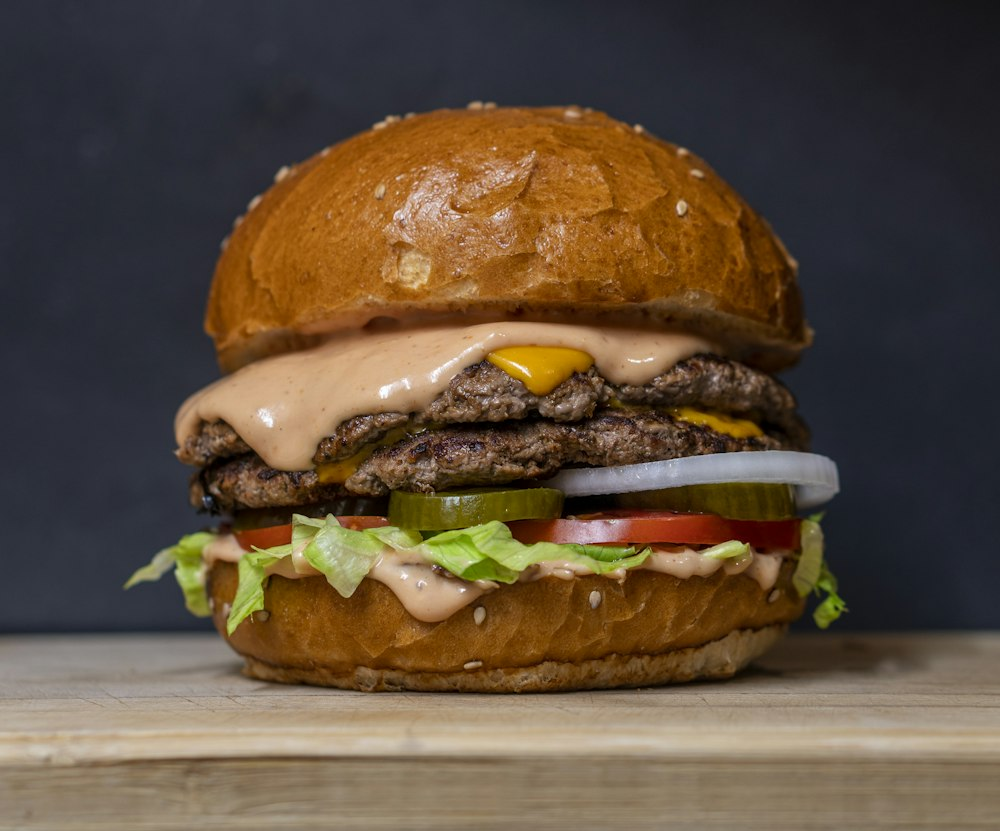

# Eatery — Premium Artisanal Restaurant Website
### ICT 213 - Web Programming 1 | Assignment 1

---

## 1. Project Overview & Objective

**Eatery** is a modern, responsive, and aesthetically refined restaurant website designed to emulate a premier culinary dining establishment. Developed as part of the **ICT 213: Web Programming 1** curriculum, this project strictly adheres to fundamental web standards, utilizing **pure HTML5** for semantic page architecture and **CSS3** for styling and responsive layouts, complemented by unobtrusive **vanilla JavaScript** for accessibility and client-side interactions.

### Core Objectives
1. Implement a complete restaurant web interface without external CSS/JS frameworks (no Bootstrap, Tailwind, React, or jQuery).
2. Establish a warm, welcoming, and high-end visual identity using a culinary palette (warm cream `#FAF7F2`, dark espresso `#2C1810`, olive green `#4A5D3E`, and muted gold `#C5A059`).
3. Fulfill all mandatory HTML structural components (Semantic Header, Hero, Top 3 Ordered List, Best Seller with fixed image attributes, Centered Daily Menu Table, and Booking/Feedback Form).
4. Demonstrate deep comprehension of the academic assessment criteria across Pass (P1–P7), Merit (M1–M2), and Distinction (D1–D2) levels.

---

## 2. Project Directory Structure

The project follows the exact structure specified in the assignment brief, using locally stored image assets to guarantee offline reliability:

```text
Eatery/
├── index.html              # Main HTML5 document containing semantic page structure
├── styles.css              # Custom CSS3 stylesheet (Design Tokens, Grid, Flexbox, Media Queries)
├── README.md               # Technical report, assessment documentation & operational guide
└── assets/                 # High-resolution local image assets (no broken external links)
    ├── hero.jpg            # Warm restaurant interior photograph for the hero section
    ├── best-seller.jpg     # Signature Classic Beef Burger photograph (600x450 ratio)
    └── other-images/       # Supplementary food photography for menu & top meals
        ├── grilled-chicken.jpg   # Top meal 01: Grilled Chicken Platter
        ├── beef-burger.jpg       # Top meal 02: Classic Beef Burger
        ├── alfredo-pasta.jpg     # Top meal 03: Creamy Alfredo Pasta
        └── ambiance.jpg          # Dining ambiance showcase
```

---

## 3. How to Run the Project

The website runs directly in any modern web browser without requiring a Node.js runtime, build tools, package managers, or local server installations:

1. **Direct File Execution**:
   - Double-click `index.html` or drag and drop it into any browser (**Google Chrome**, **Mozilla Firefox**, **Microsoft Edge**, **Apple Safari**).
2. **Local Development Server (Optional)**:
   - If using VS Code: Right-click `index.html` and select **"Open with Live Server"**.
   - If using Python: Run `python -m http.server 8000` in the `Eatery/` directory and navigate to `http://localhost:8000`.

---

## 4. Assessment Criteria Fulfillment

This section documents the theoretical concepts and practical implementations required by the assessment rubric.

### [P1] Overview of Technologies Used
The application is built on the foundational open web stack:
- **HTML5 (HyperText Markup Language 5)**: Provides the semantic structural backbone of the web application. Employs modern semantic tags (`<header>`, `<nav>`, `<main>`, `<section>`, `<article>`, `<footer>`) to construct an accessible Document Object Model (DOM).
- **CSS3 (Cascading Style Sheets Level 3)**: Manages all visual presentation, layouts, and animations. Employs **CSS Custom Properties (Variables)**, **Flexbox**, **CSS Grid**, and **Responsive Media Queries** to ensure fluid adaptation across viewport sizes.
- **Vanilla JavaScript (ECMAScript 6+)**: Implements unobtrusive interactivity strictly where necessary: responsive hamburger menu toggle, scroll-spy navigation link highlighting, and client-side form feedback simulation.
- **Local Storage Assets**: All photographs and graphic SVGs are bundled locally within `assets/` to ensure deterministic offline rendering.

---

### [P2] HTML as the Frontend Markup Language
HTML is the standard markup language used to structure content on the World Wide Web:
- **Separation of Concerns**: HTML defines *what* content is (semantics, document hierarchy, forms, lists, tables), CSS dictates *how* it looks (colors, typography, spacing), and JavaScript determines *how* it behaves (interactivity).
- **DOM Hierarchy**: The browser parses HTML text into a tree-like memory structure known as the **DOM (Document Object Model)**, enabling stylesheets and scripts to target nodes deterministically.
- **Platform Agnosticism**: Standard HTML renders predictably across operating systems (Windows, macOS, Linux, Android, iOS) and assistive technologies (screen readers like NVDA, JAWS, and VoiceOver).

---

### [P3] Correct HTML Document Structure & Essential Tags
The `index.html` file includes the full set of essential tags adhering to W3C standards:
- `<!DOCTYPE html>`: Declares HTML5 document type, forcing modern standard mode rendering.
- `<html lang="en">`: Declares language for accessibility screen readers and search engines.
- `<head>`: Encapsulates document metadata:
  - `<meta charset="UTF-8">`: Specifies UTF-8 character encoding supporting international characters and symbols.
  - `<meta name="viewport" content="width=device-width, initial-scale=1.0">`: Ensures correct mobile rendering and prevents mobile browsers from defaulting to desktop canvas zooming.
  - `<meta name="description">`: Supplies search engines with indexed snippet descriptions.
  - `<title>`: Renders the descriptive title in the browser tab and bookmark managers.
  - `<link rel="stylesheet" href="styles.css">`: Links the external cascading stylesheet.
- `<body>`: Contains visible DOM content encapsulated within semantic blocks: `<header>`, `<main>`, `<section>`, and `<footer>`.

---

### [P4] Understanding of HTTP, HTTPS, DNS, and Related Protocols
The functioning of web delivery relies on a suite of networking protocols:
1. **DNS (Domain Name System)**:
   - Acts as the Internet's directory service, translating human-readable domain names (e.g., `eatery-dining.com`) into computer-routable IP addresses (e.g., `192.0.2.1` or `2606:4700::6810`).
   - Resolution involves Recursive Resolvers, Root Servers, TLD (Top-Level Domain) Servers, and Authoritative Nameservers.
2. **HTTP (HyperText Transfer Protocol - Port 80)**:
   - An application-layer, stateless request-response protocol running over TCP.
   - The browser issues an `HTTP GET /index.html HTTP/1.1` request, and the web server returns HTTP status codes (e.g., `200 OK`, `404 Not Found`) along with the HTML payload.
3. **HTTPS (HyperText Transfer Protocol Secure - Port 443)**:
   - Layers HTTP over **TLS/SSL (Transport Layer Security)**.
   - Guarantees **Confidentiality** (encryption prevents packet eavesdropping), **Integrity** (data tampering in transit is detected via checksums), and **Authentication** (validates the server's identity using cryptographic X.509 certificates).
4. **Browser Asset Pipeline**:
   - The browser parses HTML and encounters secondary resources (`<link rel="stylesheet">`, ``). It initiates parallel HTTP/2 or HTTP/3 multiplexed requests to retrieve stylesheets and image binaries, assembling the render tree before painting pixels to the display.

---

### [M1] Understanding of Static versus Dynamic Websites

| Characteristic | Static Website (e.g., Eatery) | Dynamic Website (e.g., E-commerce / Web App) |
|---|---|---|
| **Content Generation** | Pre-authored HTML, CSS, and client-side JS files served directly as stored on disk. | Pages assembled on-the-fly at runtime via server-side code (Node.js, Python, PHP, Java). |
| **Database Requirement** | No database required; data is hardcoded in the markup. | Requires relational (PostgreSQL, MySQL) or NoSQL (MongoDB) databases. |
| **Speed & Performance** | Extremely fast; files can be cached on CDNs (Content Delivery Networks) edge servers globally. | Processing overhead due to database queries, server compute, and template rendering. |
| **Security Surface** | Minimal attack surface; immune to SQL injection, server code execution, or auth token theft. | Larger attack surface requiring constant patching against OWASP Top 10 vulnerabilities. |
| **Hosting & Maintenance** | Inexpensive/free on static hosts (GitHub Pages, Cloudflare Pages, Netlify, Amazon S3). | Requires dedicated application servers, container clusters, load balancers, and DB admin. |
| **Ideal Use Cases** | Restaurant menus, brochures, landing pages, documentation, portfolios. | Social networks, reservation engines with live seat selection, banking, user accounts. |

---

### [D1] Correct HTML Image Implementation with Dimensions & Background Images
Image delivery in `Eatery` follows high-performance standards:
- **Foreground `` Implementation**:
  - The Best Seller section features:
    ```html
    
    ```
  - **Fixed `width` and `height` attributes** allocate an intrinsic aspect ratio ($4:3$) before the image finishes downloading. This eliminates **CLS (Cumulative Layout Shift)**, a primary Google Core Web Vitals metric.
  - In CSS, responsiveness is maintained seamlessly:
    ```css
    .best-seller-img {
      width: 100%;
      height: auto;
      aspect-ratio: 4 / 3;
      object-fit: cover;
    }
    ```
  - Descriptive, contextual `alt` text supports visually impaired users navigating with screen readers and provides SEO relevance.
- **CSS Background Image Implementation**:
  - The Hero section incorporates a full-bleed atmospheric photograph (`assets/hero.jpg`):
    ```css
    .hero-section {
      background-image: url('assets/hero.jpg');
      background-size: cover;
      background-position: center center;
      background-repeat: no-repeat;
    }
    ```
  - Combined with a semi-transparent dark linear gradient overlay (`.hero-overlay`), ensuring high text contrast compliant with **WCAG 2.1 AA** contrast ratios ($> 4.5:1$).

---

### [P5] Understanding of Basic Website Content Elements
The website incorporates all fundamental HTML elements according to standard content modeling rules:
- **Heading Hierarchy**: A logical cascade from `<h1>` (single primary heading in Hero) down to `<h2>` (section headings) and `<h3>`/`<h4>` (card and footer subheadings) without skipping levels.
- **Text Blocks**: Semantic paragraphs (`<p>`), emphasis (`<strong>`, `<em>`), and addresses (`<address>`).
- **Interactive Form Controls**: `<form>`, `<label>`, `<input>`, `<select>`, `<textarea>`, and `<button>`.
- **Anchor Elements**: In-page jump anchors (`<a href="#menu">`) providing smooth scrolling transitions.

---

### [P6] Correct Ordered List Implementation
The assignment explicitly requires an ordered list (`<ol>`) for the **Top 3 Meals**:
- **Semantic Structure**:
  ```html
  <ol class="top-meals-list">
    <li class="meal-card">... 1. Grilled Chicken Platter ...</li>
    <li class="meal-card">... 2. Classic Beef Burger ...</li>
    <li class="meal-card">... 3. Creamy Alfredo Pasta ...</li>
  </ol>
  ```
- **Professional Styling**:
  - Retains semantic `<ol>` and `<li>` elements for accessibility.
  - Styled with CSS Grid (`grid-template-columns: repeat(3, 1fr)`).
  - Custom visual rank badges (`01`, `02`, `03`) styled with gold circular borders and espresso backgrounds, creating a luxury culinary presentation.

---

### [P7] Correct Static HTML Menu Table
The Daily Menu section features a centered HTML table with **exactly two columns** (`Item` and `Price`):
- **Semantic Tags Used**:
  - `<table>`: The parent tabular container.
  - `<caption class="sr-only">`: Accessible table caption for assistive technologies.
  - `<thead>`: Encloses table header row.
  - `<tbody>`: Encloses table content rows.
  - `<th>`: Header cells (`scope="col"`).
  - `<td>`: Data cells containing dish name, culinary description, and formatted price badge.
- **Exact Data Rows**:
  1. Grilled Chicken Platter | EGP 180
  2. Classic Beef Burger | EGP 150
  3. Creamy Alfredo Pasta | EGP 135
- **Centered Alignment**: Handled via `.table-container` flexbox wrapper and `margin-left: auto; margin-right: auto;` on `.menu-table`.

---

### [M2] Proper Webpage Layout
The layout architecture leverages modern CSS layout modules:
- **CSS Grid**:
  - `.top-meals-list`: 3-column desktop layout transitioning to 2-column on tablet and 1-column on mobile.
  - `.best-seller-wrapper`: 2-column layout (50/50 image and information split).
  - `.form-wrapper`: Asymmetric 2-column layout (1fr sidebar / 1.6fr form card).
  - `.footer-content`: 4-column distribution.
- **CSS Flexbox**:
  - Used for navigation header alignment, buttons, price badges, tags, and footer bottom bar.
- **Responsive Media Queries**:
  - Desktop: $> 1024\text{px}$
  - Tablet: $768\text{px} - 1024\text{px}$
  - Mobile: $< 768\text{px}$ and $< 480\text{px}$

---

### [D2] Well-Organized and Professionally Styled CSS
The stylesheet (`styles.css`) is architected with production-level discipline:
1. **Design Tokens (`:root`)**: Centralized custom properties for colors, fonts, spacing, shadows, and transitions.
2. **Modular Sectioning**: Organized logically into:
   - Section 1: CSS Custom Properties
   - Section 2: Reset & Base Typography
   - Section 3: Shared UI Components (Buttons, Badges)
   - Section A–G: Styles corresponding directly to website sections
   - Section 4: Responsive Media Queries
3. **Accessibility & Interactive States**:
   - Explicit `:hover` and `:focus-visible` styling with gold glow rings.
   - Smooth transitions using fine-tuned cubic bezier easing (`cubic-bezier(0.16, 1, 0.3, 1)`).
   - Glassmorphic header backdrop blur (`backdrop-filter: blur(12px)`).

---

## 5. Required Sections Checklist

| Section | Required Features | Status |
|---|---|---|
| **A. Navigation Header** | Restaurant name/logo (Eatery), nav links (Home, Top Meals, Best Seller, Menu, Contact), smooth scrolling, mobile menu. | **Complete** |
| **B. Hero Section** | Heading "Welcome to Eatery", description, restaurant background photo (`hero.jpg`), prominent "View Menu" button. | **Complete** |
| **C. Top 3 Meals** | Semantic `<ol>`, 3 items (Grilled Chicken Platter, Classic Beef Burger, Creamy Alfredo Pasta), luxury card styling. | **Complete** |
| **D. Best Seller** | Photo (`best-seller.jpg`), title, description, `` with descriptive `alt` and fixed `width="600"` and `height="450"`. | **Complete** |
| **E. Daily Menu** | Properly centered HTML table, exactly 2 columns (`Item` & `Price`), semantic `<thead>`, `<tbody>`, `<th>`, `<td>`, 3 exact dishes & prices in EGP. | **Complete** |
| **F. Booking & Feedback Form** | Name input, Email input, Message textarea, Submit button, Request-type dropdown (Booking / Feedback), proper labels, `required` attributes, static assignment notice. | **Complete** |
| **G. Footer** | Eatery branding, copyright notice, contact details (address, phone, hours, email), social media links with inline SVGs. | **Complete** |

---

## 6. Academic Integrity Statement
This project was authored from scratch adhering strictly to modern semantic HTML5 and CSS3 standards. No front-end frameworks (Bootstrap, Tailwind, Foundation), component libraries, or server-side runtimes were employed.
